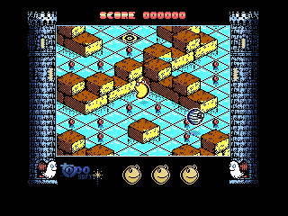

# Mad Mix 2 for MSX and V9990

**A colourful P1 conversion of Topo Soft’s 1990 MSX game, running on a Z80.** An unofficial homage port by **DiHalt Studio**, 2026.

## Play it

Download the ROM and Spanish or English manual from [Release v1.0](https://github.com/DiHaltStudio/madmix2-v9990/releases/tag/v1.0). Requires an MSX with Z80, V9990 cartridge and an ASCII16-compatible ROM loader. Put the ROM in `release/` and run `make run`. Controls: cursor keys or joystick to move; Space or fire to select and play. Choose STANDARD or HARD at the menu.

Manuals: [Español](V9990/docs/manual/manual-es.pdf) · [English](V9990/docs/manual/manual-en.pdf).

## Building from source

The original Mad Mix 2 game is not distributed here. Set `ORIGINAL_DIR` to a private workspace containing the original CAS and its reconstructed `MSX/build` images, plus the extracted opening artwork and original PSG recordings. See [building instructions](docs/BUILDING.md). Run `make build ORIGINAL_DIR=/path/to/private/workspace`.

The editable terrain, sprites, HUD, maps, palettes and P1 renderer live under `V9990/`. `make release` copies the ROM and manuals to `release/`; generated ROMs are excluded from Git.

Please improve the game if you feel so! The art, maps and palette can be edited in the included source files.

## Credits and rights

Original game: Topo Soft, 1990. V9990 conversion: DiHalt Studio, 2026. This is an unofficial port for study, preservation and homage. Original game rights and trademarks remain with their respective owners.
